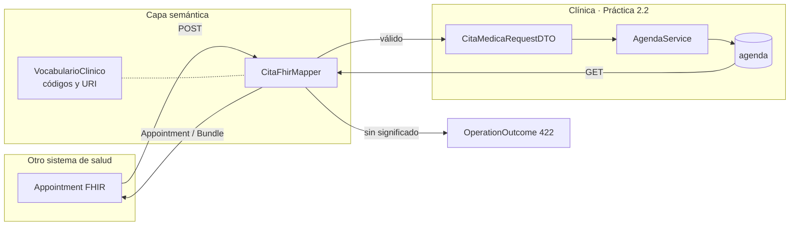

# Capa de intercambio de información semántica: la cita médica en HL7 FHIR

- **Estudiante:** William Cabrera (`4NDR3S-01`)
- **Asignatura:** Integración e Implementación de Software
- **Rama:** `practica-semantica-cita-medica`
- **Base:** contrato JSON de la cita médica (Práctica 2.2, rama `practica-dto-cita-medica`)

## 1. Problema

Con la Práctica 2.2, la API de la agenda tiene un contrato JSON validado. Ese contrato, sin embargo, solo lo entiende nuestro sistema:

```json
{ "codigo_paciente": "001", "fecha": "2026-11-20", "hora_inicio": "10:00", "estado": "programada" }
```

Un hospital, una aseguradora o el sistema del Ministerio de Salud no saben qué es un `codigo_paciente` ni qué significa `programada`. Tampoco saben que `10:00` es la hora de Ecuador. Que la estructura sea correcta (sintaxis) no garantiza que el receptor entienda lo mismo (semántica).

## 2. Solución

Se agrega una **capa semántica** que publica y recibe la cita usando un estándar internacional de salud: **HL7 FHIR R4, recurso `Appointment`**. Cada dato se expresa con un **código** que pertenece a un **vocabulario identificado por su URI**. Dos sistemas que comparten esos URI entienden lo mismo sin conocer la base de datos del otro.



La regla de negocio no se duplica. Una cita importada pasa por el **mismo** DTO y el **mismo** `AgendaService` que usan la web y el móvil, con el mismo control de horario ocupado, la misma auditoría y la misma transacción.

| Archivo | Responsabilidad |
|---|---|
| `app/Semantica/VocabularioClinico.php` | Vocabulario compartido: URI, códigos y tablas de equivalencia |
| `app/Semantica/CitaFhirMapper.php` | Traduce Agenda → Appointment y Appointment → `CitaMedicaRequestDTO` |
| `app/Semantica/ErrorSemantico.php` | Errores en formato estándar `OperationOutcome` |
| `app/Http/Controllers/Api/Semantica/CitaFhirController.php` | Endpoints `/api/semantica/...` |
| `tests/Feature/SemanticaCitaFhirTest.php` | 16 pruebas, 125 aserciones |
| `docs/contratos/cita-medica/fhir/*.json` | Ejemplos reales, validados con el esquema oficial de FHIR R4 |

## 3. Vocabulario (tabla de mapeo)

| Dato interno | FHIR `Appointment` | Vocabulario (URI) |
|---|---|---|
| `id` | `id` e `identifier` | `urn:proyect-clinico:agenda` |
| `estado` | `status` | Value set `appointmentstatus` de FHIR |
| `tipo = cita_medica` | `serviceCategory` = `10` Dental | `http://terminology.hl7.org/CodeSystem/service-category` |
| (consulta programada) | `appointmentType` = `ROUTINE` | `http://terminology.hl7.org/CodeSystem/v2-0276` |
| `fecha` + `hora_inicio` / `hora_fin` | `start` / `end`: instante con zona | ISO 8601 · zona `America/Guayaquil` (UTC−05:00) |
| `descripcion` | `description` | — |
| `paciente.codigo_paciente` | `participant.actor.identifier` | `urn:proyect-clinico:codigo-paciente` |
| `paciente.cedula` (solo al importar) | `participant.actor.identifier` | `urn:proyect-clinico:cedula-ecuador` |
| `paciente.nombres` / `nombre_reserva` | `participant.actor.display` | — |
| `created_at` | `created` | ISO 8601 |

| Estado interno | `status` FHIR | ¿Se puede importar? |
|---|---|---|
| `pendiente` | `proposed` | No |
| `programada` | `booked` | **Sí** |
| `completada` | `fulfilled` | No |
| `cancelada` | `cancelled` | No |

**Información que no se comparte:** `diagnostico`, `tratamiento`, `observacion` y las entradas personales de la agenda de la doctora. La capa semántica también decide qué información sale del sistema.

Los URN `urn:proyect-clinico:*` son convenciones de este proyecto. Los vocabularios `terminology.hl7.org` son los oficiales de HL7.

## 4. Reglas de significado al importar

El 422 no se usa solo cuando falta un campo. También se responde 422 cuando el dato **no tiene significado** para el consultorio:

| Caso | `issue.code` | Ejemplo |
|---|---|---|
| Estado sin equivalente | `code-invalid` | `"status": "arrived-late"` |
| Estado que no es una cita confirmada | `not-supported` | `"status": "proposed"` |
| Categoría que no es odontología | `code-invalid` | `serviceCategory` = 27 Mental Health |
| Paciente identificado con un sistema desconocido | `code-invalid` | `"system": "urn:otro-hospital:hc"` |
| Cédula o código que no existe | `not-found` | cédula `0999999999` |
| Hora sin zona horaria, que es ambigua | `value` | `"2026-11-20 10:00"` |
| Fin anterior al inicio, o en otro día local | `business-rule` | — |
| Horario ocupado | `conflict` (409) | — |

Todos los problemas se informan juntos en un solo `OperationOutcome`, y no se guarda nada.

**El mismo instante con otro formato es la misma cita.** `2026-11-20T15:00:00Z` (UTC) se guarda como 20/11 a las **10:00**, hora del consultorio. `2026-11-21T02:00:00Z` se guarda como el **20/11 a las 21:00**, porque en Ecuador todavía es el día anterior.

## 5. Endpoints

Todos requieren `Authorization: Bearer <token>` de la doctora. Responden con `Content-Type: application/fhir+json`.

| Método y ruta | Qué hace |
|---|---|
| `GET /api/semantica/vocabulario` | Publica la tabla de mapeo |
| `GET /api/semantica/fhir/Appointment?date=AAAA-MM-DD` | Citas del día como `Bundle` (searchset) |
| `GET /api/semantica/fhir/Appointment/{id}` | Una cita como `Appointment` |
| `POST /api/semantica/fhir/Appointment` | Importa una cita FHIR → 201 con `Location`, 409 o 422 |

## 6. Guion de demostración

Desde cualquier equipo de la red (Linux, o `curl.exe` en Windows), contra el balanceador:

```bash
API=http://100.102.99.114/api      # balanceador (L1). En local: http://127.0.0.1:8000/api
TOKEN=$(curl -s -X POST $API/auth/login -H 'Content-Type: application/json' \
  -d '{"username":"<doctora>","password":"<clave>"}' | python3 -c 'import sys,json;print(json.load(sys.stdin)["access_token"])')
H=(-H "Authorization: Bearer $TOKEN" -H 'Accept: application/fhir+json')
```

1. **El vocabulario compartido.**
   ```bash
   curl -s "${H[@]}" $API/semantica/vocabulario | python3 -m json.tool
   ```
2. **Importar una cita de un "sistema externo".** El paciente viene identificado por cédula y la hora en UTC. Se usa `docs/contratos/cita-medica/fhir/appointment-entrada-externa.json`, con una fecha libre y la cédula de un paciente real:
   ```bash
   curl -si "${H[@]}" -H 'Content-Type: application/fhir+json' \
     --data @docs/contratos/cita-medica/fhir/appointment-entrada-externa.json $API/semantica/fhir/Appointment
   ```
   Hay que mostrar la respuesta `201`, la cabecera `Location`, la hora `10:00-05:00` y que el paciente vuelve con su `codigo-paciente`.
3. **La cita aparece en la web de la doctora**, en la agenda de ese día. Es la misma información que entró por la capa semántica.
4. **Exportar el día como Bundle FHIR.**
   ```bash
   curl -s "${H[@]}" "$API/semantica/fhir/Appointment?date=2026-11-20" | python3 -m json.tool
   ```
5. **Enviar un dato sin significado.** Se reciben varios errores juntos y no se guarda nada:
   ```bash
   curl -s "${H[@]}" -H 'Content-Type: application/fhir+json' $API/semantica/fhir/Appointment \
     -d '{"resourceType":"Appointment","status":"arrived-late","start":"2026-11-20 10:00","end":"2026-11-20T10:30:00-05:00","participant":[{"actor":{"type":"Patient","display":"Ana"}}]}' | python3 -m json.tool
   ```
6. **Repetir el paso 2** → `409 conflict`, porque el horario ya está ocupado.

## 7. Pruebas y evidencias

```bash
php artisan test --filter=SemanticaCitaFhirTest      # 16 pruebas, 125 aserciones
php artisan test --filter=CitaMedicaContratoTest     # contrato 2.2 intacto: 9 pruebas
```

Las pruebas cubren lo siguiente:

- El mapeo de los cuatro estados.
- Que la exportación no expone datos clínicos ni entradas personales.
- La búsqueda por día.
- La importación con código interno, con cédula y con un paciente sin registro.
- La conversión de UTC a hora local, incluido el cruce de medianoche.
- Los códigos sin significado y las reglas de negocio.
- El 409.
- La **ida y vuelta**: exportar y volver a importar conserva `status`, `start`, `end`, `description`, `serviceCategory` y `participant`.
- El acceso solo para la doctora.

Los ejemplos de `docs/contratos/cita-medica/fhir/` son respuestas reales de la API. Se validaron con el **esquema JSON oficial de FHIR R4** publicado por HL7 (`https://hl7.org/fhir/R4/fhir.schema.json.zip`), y los cuatro documentos (entrada, Appointment creado, Bundle y OperationOutcome) resultaron válidos.

Resultado de la suite completa del backend: 180 pruebas aprobadas, 23 omitidas y 2 fallidas. Las 2 fallas son de `AuditoriaTransaccionesTest` (columna `agenda.nombre_reserva`), que ya fallaba en `upstream/master` antes de esta práctica.

## 8. Esquema sugerido para la presentación

1. **Título.** Capa de intercambio de información semántica: la cita médica en HL7 FHIR.
2. **Tres niveles de interoperabilidad.** Técnico (HTTP/JSON), sintáctico (contrato 2.2: estructura y tipos) y semántico (significado compartido).
3. **El problema.** El JSON interno frente a cómo lo leería otro sistema: `programada`, `001` y `10:00` no dicen nada fuera de la clínica.
4. **El estándar.** FHIR, sus recursos, `Appointment`, y el par *system + code* como un "diccionario con dirección" (URI).
5. **La tabla de mapeo** (sección 3) y los datos que no se comparten.
6. **La arquitectura** (diagrama de la sección 2). Se reutiliza el DTO y el servicio de la 2.2.
7. **Demostración en vivo** (sección 6).
8. **Reglas de significado y OperationOutcome** (sección 4). El ejemplo de UTC y medianoche.
9. **Evidencias.** Las pruebas, la ida y vuelta y la validación con el esquema oficial.
10. **Conclusión y trabajo futuro.** Terminologías clínicas como SNOMED CT o CIE-10 para los diagnósticos, un recurso `Patient` y perfiles nacionales.
