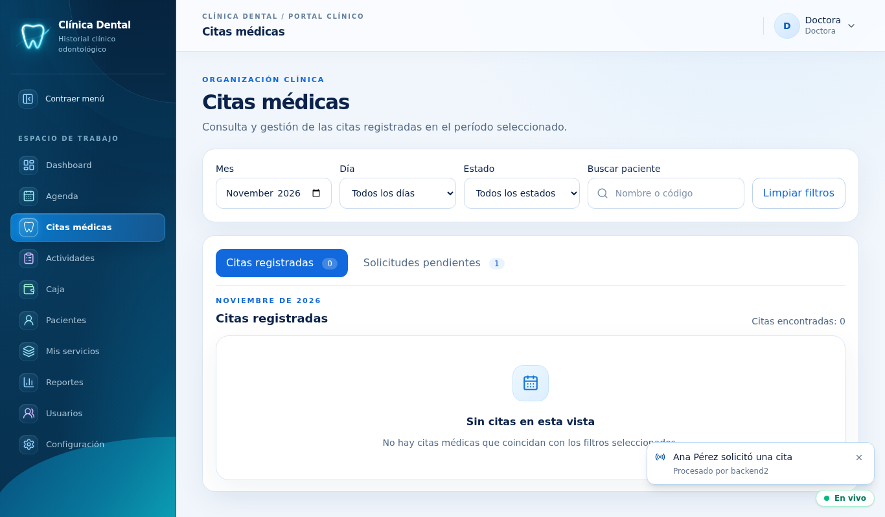

# Práctica: arquitectura reactiva y orientada a eventos — cita médica

## Qué se demuestra

Cuando una cita médica cambia, el backend **publica un evento** y los interesados
**reaccionan solos**, sin preguntar:

- el panel web de la doctora muestra un aviso y la agenda se actualiza **sin recargar**;
- una bitácora registra el evento **en segundo plano** (por una cola);
- si el servidor de eventos se cae, las citas **se siguen guardando**.

Antes, la web se enteraba de los cambios preguntando al servidor cada cierto tiempo (*pull*).
Ahora el servidor avisa en cuanto ocurre (*push*), en menos de un segundo.

### Las piezas, en una frase cada una

| Pieza | Qué hace | Dónde está |
|---|---|---|
| **Productor** | Detecta que la cita cambió y publica el evento | `backend-api/app/Observers/AgendaObserver.php` |
| **Evento** | El hecho ocurrido, con sus datos: «cita solicitada» | `backend-api/app/Events/CitaCambioEstado.php` |
| **Consumidor 1** (inmediato) | Envía el evento por WebSocket a los navegadores | `backend-api/app/Listeners/DifundirCambioDeCita.php` |
| **Consumidor 2** (por cola) | Escribe la bitácora `storage/logs/eventos.log` | `backend-api/app/Listeners/RegistrarEventoDeCita.php` |
| **Reverb** | Servidor de WebSockets: mantiene la conexión con los navegadores y les reparte los mensajes | `php artisan reverb:start` |
| **Worker** | Proceso que atiende la cola del consumidor 2 | `php artisan queue:work` |
| **Cliente reactivo** | La web de la doctora: recibe el evento, avisa y refresca la agenda | `frontend-web/src/features/realtime/` |

```
 Paciente (app o curl)                                   Web de la doctora
      │ POST /api/agenda/solicitar-cita                          ▲ aviso + agenda al día
      ▼                                                           │ (WebSocket)
   Backend ── guarda en PostgreSQL ── COMMIT                      │
      │                                                           │
      └─► AgendaObserver publica el evento CitaCambioEstado        │
              ├─► Consumidor 1 ──► Reverb ────────────────────────┘
              └─► Consumidor 2 ──► cola "eventos" ──► worker ──► eventos.log
```

---

# Parte 1 — Preparación (una sola vez, antes de presentar)

Decide **dónde** harás la demostración. Todo lo demás es igual; solo cambian estas direcciones:

| | **En tu laptop** (recomendado: lo controlas todo) | **En los 5 nodos** |
|---|---|---|
| Dirección del API (`API`) | `http://127.0.0.1:8001/api` | `http://<IP del balanceador>/api` |
| Web de la doctora | `http://localhost:5173` | `http://<IP del balanceador>` |
| Dónde se ejecutan Reverb y el worker | Tu laptop, carpeta `backend-api` | Laptop 3, carpeta `backend-api` |

En los dos casos el backend usa la base de datos del proyecto (Laptop 4), así que necesitas la red o Tailscale activos.

## 1.1 Configurar el backend

Agrega o cambia estas líneas en `backend-api/.env` (en tu laptop o en la Laptop 3):

```ini
BROADCAST_CONNECTION=reverb
QUEUE_CONNECTION=database
REVERB_APP_ID=clinica
REVERB_APP_KEY=clinica-clave
REVERB_APP_SECRET=cambia-este-secreto
REVERB_HOST=127.0.0.1
REVERB_PORT=8085
REVERB_SCHEME=http
REVERB_SERVER_HOST=0.0.0.0
REVERB_SERVER_PORT=8085
```

Luego, en `backend-api`:

```bash
composer install
php artisan config:clear
```

## 1.2 Configurar la web

**En tu laptop:** crea el archivo `frontend-web/.env.local` con:

```ini
VITE_API_BASE_URL=http://127.0.0.1:8001/api
VITE_REVERB_APP_KEY=clinica-clave
VITE_REVERB_HOST=127.0.0.1
VITE_REVERB_PORT=8085
```

y luego `npm install` en `frontend-web`.

**En los 5 nodos:** ver el [Anexo A](#anexo-a--despliegue-en-los-5-nodos).

## 1.3 Cuentas que necesitas

- La **doctora**: usuario y contraseña del sistema.
- Una **paciente de prueba** con usuario y contraseña, **sin una solicitud de cita pendiente**. Si tiene una, cancélala con el paso 7.

## 1.4 Lo que dejas corriendo antes de que empiece la presentación

No hace falta explicarlo en vivo: es el sistema «normal».

**Solo en tu laptop**, en dos terminales:

```bash
# Terminal "Backend" (carpeta backend-api)
BACKEND_INSTANCE=backend1 php -S 127.0.0.1:8001 -t public

# Terminal "Web" (carpeta frontend-web)
npm run dev
```

En los 5 nodos ya están corriendo el backend (`iniciar.ps1`), la web y NGINX.

## 1.5 Ensayo rápido (5 minutos)

Haz los pasos 1 a 9 de la Parte 2 una vez antes de presentar. Si algo no responde, revisa la [Parte 4](#parte-4--si-algo-falla).

---

# Parte 2 — Demostración en vivo, paso a paso (≈10 minutos)

Ventanas abiertas, de izquierda a derecha:

| Ventana | Para qué |
|---|---|
| **Navegador** | Web de la doctora, en la página **Citas médicas** |
| **Terminal 1 — Reverb** | La abres en el paso 1 |
| **Terminal 2 — Cola** | La abres en el paso 2 |
| **Terminal 3 — Paciente** | Aquí actúas como la paciente con `curl` (o usas la app móvil) |

Las terminales 1 y 2 van en la carpeta `backend-api` (en tu laptop o en la Laptop 3).

---

### Paso 1 — Encender el servidor de eventos (Reverb)

**Haz** (Terminal 1):
```bash
php artisan reverb:start --debug
```

**Verás:** `INFO  Starting server on 0.0.0.0:8085.` Con `--debug` irá mostrando cada conexión (`Connection Established`) y cada mensaje.

**Explica:**
> «Reverb es el servidor de WebSockets. Mantiene una conexión abierta con cada navegador y les reparte los mensajes. Es el canal por donde viajan los eventos.»

---

### Paso 2 — Encender el consumidor de la cola (worker)

**Haz** (Terminal 2):
```bash
php artisan queue:work --queue=eventos,default --sleep=1
```

**Verás:** la terminal queda esperando. Cada vez que llegue un evento mostrará una línea `RegistrarEventoDeCita ... DONE`.

**Explica:**
> «Este proceso atiende la cola de eventos. Trabaja aparte del que atiende a los usuarios: por eso nadie espera a que se escriba la bitácora.»

---

### Paso 3 — La doctora se conecta

**Haz** (Navegador):
1. Inicia sesión como doctora y entra a **Citas médicas**.
2. Abre las herramientas de desarrollo (**F12**) → pestaña **Red** (*Network*) → filtro **WS**.

**Verás:**
- Abajo a la derecha: **● En vivo** (en verde).
- En la pestaña WS, una conexión abierta. En *Mensajes* aparece `pusher:subscribe` al canal `private-clinica.doctora`.
- En la Terminal 1, una conexión nueva.

**Explica:**
> «La web abrió un WebSocket y se suscribió a un canal **privado**. El backend comprobó que es la doctora antes de dejarla entrar. Una paciente no puede escuchar este canal.»

---

### Paso 4 — La paciente inicia sesión

**Haz** (Terminal 3). Primero guarda la dirección del API (ver la tabla de la Parte 1):
```bash
API=http://127.0.0.1:8001/api
```

Inicia sesión como la paciente:
```bash
curl -s -X POST $API/auth/login -H 'Accept: application/json' -H 'Content-Type: application/json' \
  -d '{"username":"USUARIO_PACIENTE","password":"CONTRASEÑA"}' | jq
```

**Verás:** una respuesta JSON con `"access_token": "5|AbC..."`. Cópiala y guárdala:
```bash
TOKEN='5|AbC...'
```

**Explica:**
> «La paciente se identificó. Con este token actuará como lo haría la app móvil.»

*(Si usas la app móvil, solo inicia sesión ahí y salta este paso.)*

---

### Paso 5 — Evento 1: la paciente solicita una cita ⭐ (el paso central)

**Haz** (Terminal 3):
```bash
curl -i -X POST $API/agenda/solicitar-cita -H 'Accept: application/json' -H "Authorization: Bearer $TOKEN"
```

**Verás**, en este orden (señala cada ventana):
1. **Terminal 3:** `HTTP/1.1 201 Created`. En el JSON, copia el `"id"` de la cita y guárdalo:
   ```bash
   CITA='01a1e95f-...'
   ```
2. **Navegador:** aparece el aviso **«(nombre) solicitó una cita»** y el contador de *Solicitudes pendientes* sube **sin recargar la página**. En la pestaña WS, un mensaje `cita_actualizada` con los datos del evento.
3. **Terminal 1 (Reverb):** `Message Received` / `Message Handled`, el mensaje que repartió.
4. **Terminal 2 (Cola):** `App\Listeners\RegistrarEventoDeCita ... DONE`.

**Explica:**
> «La paciente solo hizo **una** petición. El backend guardó la cita y publicó **un** evento. Dos consumidores reaccionaron por su cuenta: uno avisó a la doctora al instante y el otro escribió la bitácora por la cola. La paciente no sabe que existen: eso es el **desacoplamiento** de publicar/suscribir.»

---

### Paso 6 — Evento 2: la doctora programa la cita

**Haz** (Navegador): pestaña **Solicitudes pendientes** → **Programar** → elige una fecha futura y una hora → guardar.

**Verás:** un nuevo mensaje `cita_actualizada` con `"tipo": "programada"` en la pestaña WS, en la Terminal 1 y en la Terminal 2.

**Explica:**
> «Ahora la que produce el evento es la doctora. El mismo evento viaja también al canal privado de la paciente: su app podría enterarse sin preguntar.»

---

### Paso 7 — Evento 3: la paciente cancela

**Haz** (Terminal 3):
```bash
curl -i -X PUT $API/agenda/mis-citas/$CITA/cancelar -H 'Accept: application/json' -H "Authorization: Bearer $TOKEN"
```

**Verás:** `HTTP/1.1 200`, el aviso **«(nombre) canceló su cita»** y la agenda actualizada sola.

**Explica:**
> «No tuve que programar un aviso para cada acción. El **observador** del modelo convierte cualquier cambio de estado de la cita en un evento con su tipo.»

---

### Paso 8 — La bitácora

**Haz** (Terminal 3, o una terminal nueva en la carpeta `backend-api`):
```bash
tail -n 3 storage/logs/eventos.log
```
(En Windows: `Get-Content storage\logs\eventos.log -Tail 3`)

**Verás:** una línea JSON por evento: `cita.solicitada`, `cita.programada`, `cita.cancelada`.

**Explica:**
> «Este es el segundo consumidor. Escribió cada evento en segundo plano, sin que nadie esperara.»

---

### Paso 9 — Resiliencia: se cae el servidor de eventos

**Haz:**
1. En la **Terminal 1**, presiona **Ctrl+C** para apagar Reverb.
2. Mira el **Navegador**: el indicador cambia a **● Sin conexión en vivo**.
3. En la **Terminal 3**, repite la solicitud del paso 5:
   ```bash
   curl -i -X POST $API/agenda/solicitar-cita -H 'Accept: application/json' -H "Authorization: Bearer $TOKEN"
   ```
4. Muestra el log del backend:
   ```bash
   grep "No se pudo difundir" storage/logs/laravel-*.log | tail -n 1
   ```
5. Vuelve a encender Reverb en la **Terminal 1**: `php artisan reverb:start --debug`.

**Verás:**
- La solicitud respondió **`201 Created`**: la cita **se guardó igual**.
- El log dice `No se pudo difundir el evento de la cita por WebSocket`.
- La **Terminal 2** sí procesó el evento: la bitácora no depende de Reverb.
- Al volver Reverb, el navegador regresa solo a **● En vivo**, sin recargar.

**Explica:**
> «Falló el sistema de avisos, no el negocio. Los consumidores son independientes: uno falló y el otro siguió. Es **degradación controlada**, igual que con el servidor de archivos en la Unidad 3.»

**Al terminar:** cancela esta última solicitud copiando su `id` y repitiendo el paso 7, para dejar a la paciente lista para otra demostración.

---

# Parte 3 — Mostrar el código (2 minutos)

Abre los archivos en este orden (están en `backend-api/`, salvo el último):

| # | Archivo | Qué señalar |
|---|---|---|
| 1 | `app/Observers/AgendaObserver.php` | `implements ShouldHandleEventsAfterCommit`: solo publica si la cita **se guardó de verdad**. El `match` traduce el cambio de estado en el tipo de evento. |
| 2 | `app/Events/CitaCambioEstado.php` | El evento: datos del hecho y la `instancia` del backend que lo produjo. |
| 3 | `app/Providers/AppServiceProvider.php` | Las dos líneas `Event::listen(...)`. **Agregar un consumidor nuevo es una línea**, sin tocar al productor. |
| 4 | `app/Listeners/DifundirCambioDeCita.php` | El `try/catch`: por eso el paso 9 respondió 201. |
| 5 | `app/Listeners/RegistrarEventoDeCita.php` | `implements ShouldQueue`: esa sola palabra lo manda a la cola. |
| 6 | `routes/channels.php` | Quién puede escuchar cada canal privado. |
| 7 | `frontend-web/src/features/realtime/LiveAppointments.tsx` | Al llegar el evento: `invalidateClinicalQueries(['agenda'])` (refresca) y el aviso. |

---

# Parte 4 — Si algo falla

| Síntoma | Causa probable | Solución |
|---|---|---|
| La web dice **● Sin conexión en vivo** todo el tiempo | Reverb no está corriendo, o la clave no coincide | Revisa la Terminal 1. `VITE_REVERB_APP_KEY` (web) debe ser igual a `REVERB_APP_KEY` (backend). Reinicia `npm run dev` si cambiaste `.env.local`. |
| La web dice **● En vivo** pero no llega el aviso | El backend no publica en Reverb | En `backend-api/.env`: `BROADCAST_CONNECTION=reverb`. Luego `php artisan config:clear` y reinicia el backend. |
| No aparece el indicador **En vivo** | La sesión no es de la doctora, o falta `VITE_REVERB_APP_KEY` | Inicia sesión como doctora. Revisa `frontend-web/.env.local`. |
| Al solicitar: **409** «Ya tienes una solicitud de cita pendiente» | La paciente ya tiene una pendiente | Cancélala (paso 7 con su `id`) o usa otra paciente. |
| **401 Unauthenticated** en `curl` | Token mal copiado o vencido | Repite el paso 4. El token va entre comillas simples. |
| La bitácora no cambia | El worker no está corriendo | Revisa la Terminal 2. Si cambiaste `.env`, reinícialo (Ctrl+C y otra vez el paso 2). |
| `Address already in use` al iniciar Reverb | Ya hay otro Reverb abierto | Ciérralo, o busca el proceso con `lsof -i :8085`. |
| `jq: command not found` | Falta `jq` | Quita `\| jq` del comando: el JSON sale en una sola línea; busca `access_token`. |

---

# Anexos

## Anexo A — Despliegue en los 5 nodos

1. **`red.env` en todas las laptops:** agregar `REVERB_PORT=8085` y `REVERB_APP_KEY=clinica-clave` (ver `infraestructura/red.env.example`).
2. **Laptop 3 (backend):** el bloque de la sección 1.1 en `backend-api\.env`. Luego `composer install` y `.\instalar.ps1`, que abre el puerto 8085 solo para el balanceador.
   Para la demo, en vez de los pasos 1 y 2 puedes usar `.\eventos.ps1`, que abre Reverb y el worker en dos ventanas.
3. **Laptop 1 (balanceador):** `sudo ./balanceador/instalar.sh`. Agrega a NGINX el paso de WebSockets `/app/` → Laptop 3:8085.
4. **Laptop 2 (web):** `.\instalar.ps1`. Vuelve a compilar la web con las variables `VITE_REVERB_*`, tomadas de `red.env`.
5. **Comprobar:** en la web de la doctora debe aparecer **● En vivo**.

Con dos instancias del backend, el aviso muestra «Procesado por backend1» o «backend2». Sirve para explicar que ambas publican al mismo Reverb (balanceo).

## Anexo B — El mensaje que viaja por el WebSocket

```json
{
  "evento_id": "9f3b9865-aba7-4f8a-9141-070ad277145a",
  "tipo": "solicitada",
  "cita_id": "01a1e95f-be51-7145-87cb-16b0a73d581d",
  "paciente_id": "01a1e95e-9edf-7149-9167-fe7d0b487b9b",
  "paciente_nombre": "Ana Pérez",
  "estado": "pendiente",
  "fecha": null,
  "hora_inicio": null,
  "instancia": "backend1",
  "ocurrido_en": "2026-11-17T06:58:48-05:00"
}
```

Tipos de evento: `solicitada`, `creada`, `programada`, `reprogramacion_solicitada`, `reprogramada`, `cancelada`, `completada`, `actualizada`.

## Anexo C — Principios reactivos que se cumplen

- **Responsivo:** la doctora ve la solicitud en menos de un segundo; la paciente recibe su 201 sin esperar a la bitácora.
- **Resiliente:** si Reverb se cae, las citas se guardan igual (paso 9). Si el worker se detiene, los eventos esperan en la cola.
- **Elástico:** las dos instancias del backend publican al mismo Reverb.
- **Orientado a mensajes:** las piezas se comunican con mensajes asíncronos, sin conocerse entre sí.

## Anexo D — Respaldo automático y oyente de terminal

- `infraestructura/pruebas/demo-eventos.sh <API>` hace los eventos de los pasos 5 a 7 (más una reprogramación) presionando Enter. Úsalo solo si algo falla en vivo.
- `node frontend-web/scripts/escuchar-eventos.mjs <API> <host> <puerto> clinica-clave` imprime en una terminal los mismos eventos que recibe la web. Sirve si no puedes mostrar el navegador.

## Anexo E — Pruebas automatizadas

```bash
cd backend-api && php artisan test --filter=EventosCitaTest     # 10 pruebas
cd frontend-web && npx vitest run src/features/realtime          # 4 pruebas
```

| Prueba | Qué demuestra |
|---|---|
| `test_patient_request_publishes_a_solicitada_event` | El productor publica el evento correcto. |
| `test_each_state_change_publishes_its_own_event_type` | Programar, reprogramar y cancelar producen tres eventos distintos, en orden. |
| `test_changes_that_are_not_relevant_…` | Cambios sin importancia no generan eventos. |
| `test_no_event_is_published_when_the_transaction_rolls_back` | Sin COMMIT no hay evento. |
| `test_domain_event_has_two_independent_subscribers` | Dos consumidores suscritos. |
| `test_the_log_subscriber_runs_through_the_queue` | La bitácora va por la cola `eventos`. |
| `test_broadcast_goes_to_the_doctor_and_to_the_patient_private_channels` | Canales y contenido del mensaje. |
| `test_a_websocket_failure_does_not_break_the_request` | Reverb caído: igual responde 201. |
| `test_private_channels_are_authorized_only_for_their_owner` | Seguridad de los canales privados. |
| `LiveAppointments.test.tsx` | La web refresca la agenda, avisa y cierra la conexión al salir. |

Captura del ensayo (17-nov-2026): el aviso llegó 485 ms después de la solicitud.



## Anexo F — Preguntas probables

**¿Qué diferencia hay entre un evento y una petición?**
Una petición pide algo y espera respuesta («créame una cita»). Un evento informa algo que ya pasó («se solicitó una cita») y no espera nada de quien lo escucha.

**¿Por qué WebSocket y no consultar cada X segundos (polling)?**
Con polling el aviso llega con hasta X segundos de retraso, y hay peticiones aunque nada cambie. El WebSocket deja la conexión abierta y el servidor avisa en cuanto ocurre.

**¿Por qué un consumidor inmediato y otro por cola?**
El aviso tiene que ser inmediato, y si falla no pasa nada grave: la web se pone al día en su siguiente consulta. La bitácora no puede perderse pero no es urgente: la cola la separa de la petición y la reintenta hasta 3 veces.

**¿Qué pasa si se cae el worker?**
Los eventos quedan guardados en la tabla `jobs` y se procesan cuando vuelve. No se pierden.

**¿Qué pasa si se cae Reverb?**
Las citas se siguen guardando, el backend deja una advertencia en el log y la web muestra «Sin conexión en vivo». Al volver Reverb, la web se reconecta sola (paso 9).

**¿Se podría avisar de una cita que al final no se guardó?**
No. El observador publica solo después del COMMIT (`ShouldHandleEventsAfterCommit`).

**¿Quién puede escuchar los eventos?**
Solo quien autoriza `routes/channels.php`: la doctora en `clinica.doctora`, y cada paciente únicamente en su propio `paciente.{id}`. Se valida con el mismo token de la sesión.

**¿Por qué Reverb y no Kafka o RabbitMQ?**
Reverb es el servidor de WebSockets oficial de Laravel. Corre en PHP sin servicios extra y encaja con la decisión del equipo de no usar contenedores. Para el volumen de una clínica alcanza. Si creciera, Reverb puede escalar con Redis y la cola podría pasar a RabbitMQ sin cambiar el productor ni los consumidores.

**¿Qué se podría agregar?**
Que la app móvil escuche el canal de la paciente para avisarle cuando la doctora programa su cita, y un tercer consumidor que envíe recordatorios por correo.
