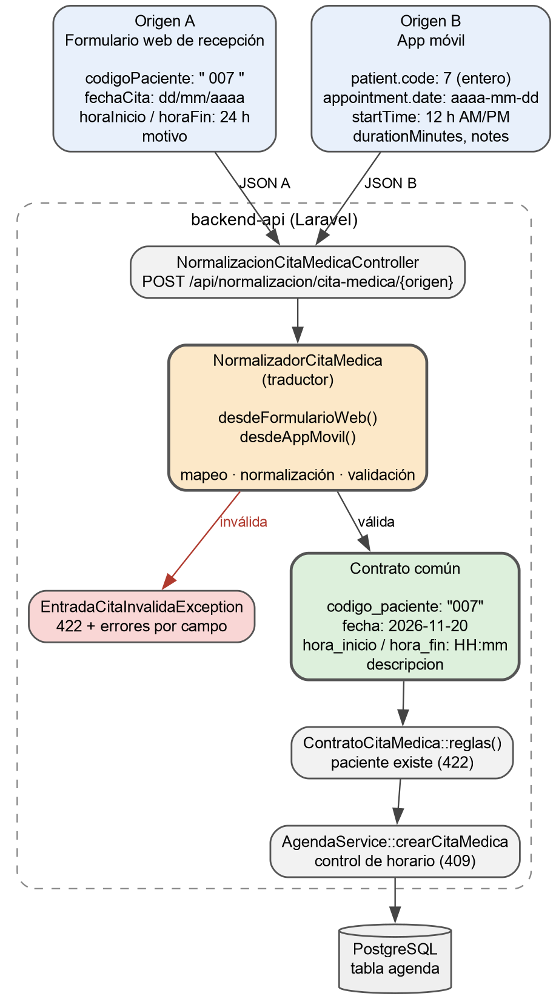

# Práctica 2.3: Traducción y normalización de la cita médica

William Andres Cabrera Palacios · IS-803, 8.º A · Rama `practica-normalizacion-cita-medica`

## 1. Conflicto estructural

Escogí el registro de citas médicas (`POST /api/agenda/cita-medica`) porque la cita se puede crear desde la
web y desde la app móvil, y cada una manda los datos de forma distinta.

El formulario web (origen A) manda los campos en español, la fecha como dd/mm/aaaa y las horas en 24 horas.
La app móvil (origen B) manda los datos dentro de `patient` y `appointment`, el código como número, la hora
con AM/PM y la duración en lugar de la hora de fin.

Diferencias:

1. Nombres: `codigoPaciente`, `patient.code` y `codigo_paciente`.
2. Estructura: plana en la web y anidada en el móvil.
3. Tipos: el código es texto en la web y entero en el móvil.
4. Formatos: `20/11/2026` y `9:00` en la web, `2026-11-20` y `09:00 AM` en el móvil.
5. El móvil manda la duración y no la hora de fin.

Contrato común (el mismo JSON que ya recibe el backend, sin cambios):

```json
{"codigo_paciente":"007","fecha":"2026-11-20","hora_inicio":"09:00","hora_fin":"09:30","descripcion":"Limpieza dental"}
```

## 2. Tabla de mapeo

```jsonc
// Origen A (formulario web)
{"codigoPaciente":" 007 ","fechaCita":"20/11/2026","horaInicio":"9:00","horaFin":"9:30","motivo":"  Limpieza   dental "}
// Origen B (app móvil)
{"patient":{"code":7},"appointment":{"date":"2026-11-20","startTime":"09:00 AM","durationMinutes":30,"notes":"Limpieza dental"}}
```

| Origen A (web) | Origen B (móvil) | Contrato común | Regla aplicada |
|---|---|---|---|
| `codigoPaciente` (texto) | `patient.code` (entero) | `codigo_paciente` (`"007"`) | Renombrar y quitar espacios. Web: solo dígitos. Móvil: solo entero. Completar a 3 dígitos. |
| `fechaCita` (dd/mm/aaaa) | `appointment.date` (aaaa-mm-dd) | `fecha` (aaaa-mm-dd) | Pasar a aaaa-mm-dd y revisar que la fecha exista. |
| `horaInicio` (24 h) | `appointment.startTime` (AM/PM) | `hora_inicio` (HH:mm) | Web: agregar el cero. Móvil: pasar de 12 a 24 horas. |
| `horaFin` (24 h) | `appointment.durationMinutes` | `hora_fin` (HH:mm) | Web: igual que la hora de inicio. Móvil: inicio + duración (5 a 480 min). Debe ser mayor que el inicio. |
| `motivo` | `appointment.notes` | `descripcion` | Quitar espacios sobrantes. Si queda vacío, `null`. |
| Otros campos | Otros campos | No aplica | Se rechaza. |

## 3. Implementación

| Archivo | Qué hace |
|---|---|
| `app/Services/Normalizacion/NormalizadorCitaMedica.php` | Traductor con `desdeFormularioWeb()` y `desdeAppMovil()`. |
| `app/Services/Normalizacion/ContratoCitaMedica.php` | Campos y reglas del contrato común. |
| `app/Exceptions/Normalizacion/EntradaCitaInvalidaException.php` | Error 422 con los errores de cada campo. |
| `app/Http/Controllers/Api/Normalizacion/NormalizacionCitaMedicaController.php` | Llama al traductor y guarda la cita con `AgendaService`. |
| `routes/api.php` | Rutas `/api/normalizacion/cita-medica/{web\|movil}` y `.../registrar` (rol doctora). |

Si un dato viene en otro formato, por ejemplo el código como `"7"` en el móvil, no se corrige: se devuelve
un error 422 con todos los campos que fallaron. Después se revisa que el paciente exista y `AgendaService`
revisa que el horario esté libre.

## 4. Interoperabilidad

Las dos entradas dan el mismo resultado, con los mismos valores y tipos. Si registro la cita desde la web y
después la misma desde el móvil, el backend responde 409 porque ya existe. Dejé la conversión en un servicio
y no en los controladores para no repetir las reglas.

## 5. Diagrama



## 6. Pruebas

| Caso | Entrada | Esperado | Obtenido |
|---|---|---|---|
| P1 | Entrada A válida | Contrato común correcto | Correcto (200) |
| P2 | Entrada B equivalente | Mismo significado y tipos que P1 | Igual a P1 |
| P3 | Campo faltante o valor inválido | Error explícito | 422 por cada campo |

```bash
php artisan test --filter=Normaliz   # 33 passed
```
